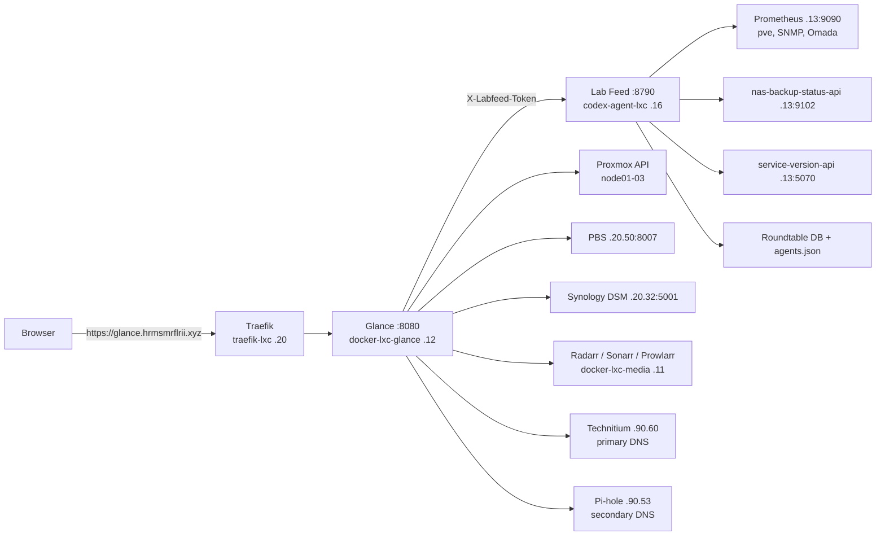

# Glance Homelab Dashboard

Configuration and custom CSS for the [Glance](https://github.com/glanceapp/glance) dashboard that fronts my homelab, plus the older helper APIs. It is the first screen I open: an overview, the Roundtable agent team, then one page per infrastructure area and a news page.

**Status (2026-10-18): redesigned and live.** Glance runs on `docker-lxc-glance` (CT200, 192.168.40.12) and is published at `https://glance.hrmsmrflrii.xyz` through Traefik. The config in this repo is the deployed one; it contains no secrets (only `${VAR}` references).

| Property | Value |
|----------|-------|
| Host | `docker-lxc-glance` (LXC CT200 on node01), 192.168.40.12 |
| Install path | `/opt/glance` |
| Port | 8080 |
| Image | `glanceapp/glance:latest` |
| Config | `config/glance.yml` + one file per page in `config/pages/` (~125 KB), 9 pages |
| Styling | `assets/lab.css` (warm-amber theme, KPI tiles, status colours, phone layout under 700 px) |
| Live data | **Lab Feed** (`:8790` on the Roundtable host CT211) plus Proxmox, Arr, Prometheus, PBS and DSM |

## Pages

| Page | Highlights |
|------|-----------|
| 🏠 **Overview** | Lab Status (health from Lab Feed), clock, weather, calendar, markets, life progress |
| 🤖 **Roundtable** | Needs You (approvals, incidents, findings), Coming Up (timers), AI spend, the team (cards link to the portal), recent activity, open issues |
| 🛠 **Services** | Health and version of every service; **Update** files a Roundtable approval through Lab Feed (no key in the page) |
| 💻 **Compute** | Proxmox nodes and guests (templates excluded), container monitoring |
| 💾 **Storage** | Synology NAS capacity, drive health and temperatures, RAID, Proxmox storage pools, Grafana panels |
| 🌐 **Network** | Internet speed and latency (one widget), Technitium (primary DNS) and Pi-hole (secondary) stats, Omada devices, VLAN client counts, Grafana panels |
| 📦 **Backup** | PBS jobs, per-VM/CT backup status, NAS sync |
| 🎬 **Media** | Library summary, downloads, Radarr/Sonarr queues, Prowlarr indexers |
| 📰 **News** | Tech YouTube and RSS; Reddit merged into multireddits (`cache: 2h`) |

Pages are included from `glance.yml` with `$include: pages/<name>.yml` (each page file is itself a `- name:` list item). Repeated service and node widgets use YAML anchors.

## Architecture



Lab Feed (`labfeed.py`) is part of the Roundtable agent code, not this repo. It serves read-only JSON (`/api/{overview,nas,network,services,roundtable,cluster,backups}`, cached 30 s) so the dashboard and the agents read the same facts. A `glance-check` timer scans every page for widget errors every 30 minutes.

## Repository layout

```
.
├── config/
│   ├── glance.yml          # theme, branding, page includes
│   ├── pages/              # one file per page (overview, roundtable, services, ...)
│   ├── docker-compose.yml  # Glance container
│   └── .env.example        # variables referenced as ${VAR}
├── assets/
│   ├── lab.css             # current styling
│   └── custom-themes.css   # pre-2026-10-18 styling (no longer referenced)
├── apis/                   # helper APIs (one folder each, with Dockerfile/compose)
│   └── _retired/           # APIs no longer wired into the dashboard
├── service.yml             # legacy GitOps metadata (see below)
├── .gitlab-ci.yml          # legacy GitLab pipeline (see below)
└── CHANGELOG.md
```

## Deploy

1. Create an LXC or VM with Docker (CT200 is an LXC; `security_opt: apparmor=unconfined` is needed for Docker inside it).
2. Copy the files:
   ```bash
   sudo mkdir -p /opt/glance && sudo chown $USER /opt/glance
   cp config/docker-compose.yml /opt/glance/
   mkdir -p /opt/glance/config /opt/glance/assets
   cp -r config/glance.yml config/pages /opt/glance/config/
   cp assets/lab.css /opt/glance/assets/
   cp config/.env.example /opt/glance/.env && chmod 600 /opt/glance/.env   # fill in values
   ```
3. Start it: `cd /opt/glance && docker compose up -d`.
4. Deploy the helper APIs you want from [`apis/`](apis/README.md) (`docker compose up -d --build` in each folder).
5. Add a Traefik router for `glance.<domain>` pointing at `http://192.168.40.12:8080`.

Glance reloads `glance.yml` automatically when the file changes; a restart is only needed after changing `.env` or `docker-compose.yml`.

### Secrets

`glance.yml` references these variables; Glance refuses to start if one is missing:

| Variable | Purpose |
|----------|---------|
| `GLANCE_PVE_AUTH` | `PVEAPIToken=CHANGE_ME for Compute/Storage widgets (read-only `PVEAuditor` is enough) |
| `GLANCE_RADARR_KEY`, `GLANCE_SONARR_KEY`, `GLANCE_PROWLARR_KEY` | Media page |
| `LABFEED_TOKEN` | Lab Feed widgets (sent as `X-Labfeed-Token`) |
| `GLANCE_TECHNITIUM_TOKEN` | Technitium widget on the Network page (token of a read-only Technitium user) |

## Making changes

The source of truth is this config (kept in my vault and copied here). Edit `config/` or `assets/`, copy them to `/opt/glance` (strip CRLF), validate, then recreate the container:

```bash
docker run --rm -v /opt/glance/config:/app/config --env-file /opt/glance/.env glanceapp/glance config:validate
cd /opt/glance && docker compose up -d --force-recreate glance
grep -rnE 'X-Api-Key: "CHANGE_ME' config   # must print nothing before committing
```

Example custom API widget:

```yaml
- type: custom-api
  title: Backup Jobs
  cache: 5m
  url: http://192.168.40.13:9102/status
  template: |
    <div>{{ .JSON.String "nas_sync_duration" }}</div>
```

## Legacy GitLab pipeline

`.gitlab-ci.yml` and `service.yml` came from the GitOps setup on the self-hosted GitLab (`homelab/glance-homelab`). They have not been used for recent changes: the live `.env` the pipeline writes is empty and the config has been edited on the host since. They are kept for reference and still mention OPNsense, which was replaced by TP-Link Omada.

## Troubleshooting

| Symptom | Check |
|---------|-------|
| Page blank / 502 via domain | `ssh docker-lxc-glance "docker ps; docker logs --tail 50 glance"`, then Traefik |
| Glance exits on start | A `${VAR}` in `glance.yml` is not set in `.env` |
| Widget shows "error" | `curl` the widget's URL from the Glance host; most APIs live on .13 |
| Pi-hole widget empty | `curl -s localhost:5055/api/pihole/stats` on CT200; Pi-hole v6 password changed? |
| Lab Feed widgets show errors | `LABFEED_TOKEN` matches the Roundtable host's and `labfeed.service` runs on CT211 |
| Update button does nothing | It files a Roundtable approval; check `#homelab-infrastructure` |

## Related

- [homelab-infrastructure](https://github.com/herms14/homelab-infrastructure): the rest of the homelab
- Blog post: [Building Glance Into Something Useful](https://herms14.github.io/Clustered-Thoughts/posts/building-glance-into-something-useful/)
- [Glance docs](https://github.com/glanceapp/glance/blob/main/docs/configuration.md)